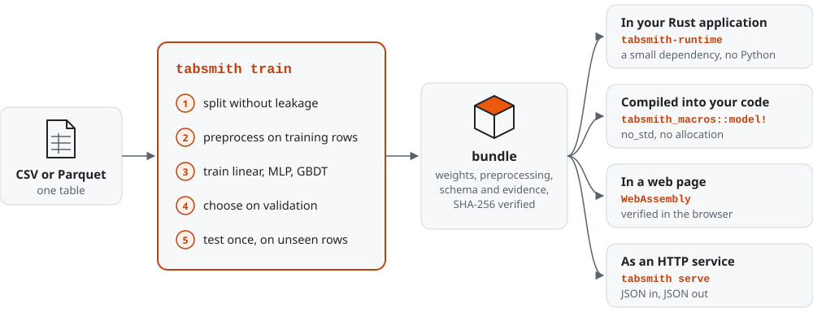
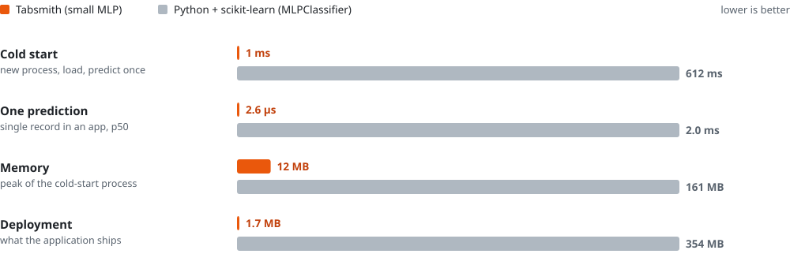

<div align="center">

<picture>
  <source media="(prefers-color-scheme: dark)" srcset="docs/assets/logo-dark.svg">
  
</picture>

# Tabsmith

**Train a model from a CSV and ship it inside your Rust application — one tool, no Python.**

[](https://github.com/NatMartini/Tabsmith/actions/workflows/ci.yml)
[](#license)
[](#install)

[中文说明](README.zh-CN.md) · [Install](#install) · [Quick start](#quick-start) · [Ship it](#ship-it-four-ways) · [Tabsmith vs Python](#tabsmith-vs-python) · [Docs](#documentation)

</div>

<picture>
  <source media="(prefers-color-scheme: dark)" srcset="docs/assets/pipeline-dark.svg">
  
</picture>

```console
$ tabsmith sample-data machines.csv
$ tabsmith train machines.csv --target defect --group device_id
· data machines.csv: 10000 rows × 25 columns, binary target `defect` (positive "1": 1289 rows, negative "0": 8711 rows)
· run-001: training linear (up to 1740 steps)
· run-001: completed (early stopping after epoch 39; weights of best epoch 29 kept)
· run-002: training small-mlp (up to 3480 steps)
· run-002: completed (early stopping after epoch 13; weights of best epoch 5 kept)
· run-003: training gbdt (up to 400 steps)
· run-003: completed (early stopping after epoch 54; weights of best epoch 29 kept)

comparison on the validation split (metric: balanced_accuracy)
  run      candidate  balanced_accuracy  AUC     F1      params  p95 latency  train time
  run-001  linear     0.7644             0.8385  0.4602  36      1 µs         106 ms
  run-002  small-mlp  0.7665             0.8427  0.4843  1697    1 µs         96 ms
  run-003  gbdt       0.7530             0.8461  0.4784  1769    1 µs         797 ms

chosen on validation: run-002 (small-mlp)
test split (1386 rows, used once): balanced accuracy 0.7729  AUC 0.8250  F1 0.4624  precision 0.3325  recall 0.7588
bundle: bundles/run-002 (b-…, evaluated; self-check passed)

$ tabsmith predict --input new.csv --keep unit_id   # CSV of predictions
$ tabsmith serve                                    # HTTP API on :8080
```

*(Real output of the Quick start below, abridged: progress lines and some table
columns are left out. Full output in the [acceptance report](reports/implementation-acceptance.md#one-command-tabsmith-train).)*

Tabsmith turns a CSV or Parquet file into a **tested, self-contained model bundle**
that any Rust program can load with a small dependency, `tabsmith-runtime`.
It covers the whole job, not just the model: it splits the data without leaking it,
learns the preprocessing from the training rows only, trains a linear baseline, a small
neural network and gradient-boosted trees, compares them fairly, uses the test set
once, and packages the winner with its preprocessing, schema and evidence. When new data arrives,
it retrains and tells you whether the new model beats the one you shipped,
on rows neither of them has seen.

Release 0.1 does **tabular binary classification, multiclass classification and
regression** (churn, defect, fraud, failure mode, remaining life, …). It trains on the
CPU, and optionally the neural networks on a GPU (Vulkan, CUDA). The runtime also
runs in a web page, compiled to WebAssembly, and a model can be compiled into your Rust
code, down to a microcontroller without the standard library. See [status](#status) for what is not done
yet, and the [design decisions](docs/design-decisions.md) and
[technical report](docs/technical-report.md) for why it is built this way.

## Why Tabsmith

- **One command, safe defaults.** `tabsmith train data.csv --target y` does split → preprocess → train three models → compare on validation → test once → bundle. Every step is recorded and reproducible.
- **Ship without Python.** Your application depends on `tabsmith-runtime` only (no Burn, no Polars, no Python). The example app is a 1.7 MB binary.
- **Or compile the model in.** `tabsmith_macros::model!` turns a bundle into Rust code while your crate builds: typed inputs, no allocation, no `std`, and the same bits as the runtime on every platform. In the embedded example, the Kani model checker proves that prediction never panics, for every possible input ([below](#compiled-into-your-code)).
- **Fast where it matters in production.** Single-record prediction in microseconds, about a millisecond from process start to first prediction, about 12 MB of memory ([numbers below](#tabsmith-vs-python)).
- **Same quality as scikit-learn.** Preprocessing matches scikit-learn's to about 2e-7, the linear model lands within about 0.1 % of scikit-learn's optimum of the same objective, and metrics match to 1e-12 ([measured](reports/implementation-acceptance.md#reference-check-against-scikit-learn); CI guards 1e-5, 1 % and 1e-12 with [frozen goldens](fixtures/reference/)).
- **Deterministic, to the bit.** Same data and settings, same weights: an interrupted run resumes to exactly the weights of an uninterrupted one, on the CPU and on certified GPUs ([why that took work on GPUs](docs/design-decisions.md#d5-determinism-is-a-contract)).
- **Mistakes are hard to make.** No train/test leakage by construction, one use of the test set per data version, entity-aware splits, refusal instead of silent fallback, integrity-checked bundles, and errors that say what to do next.
- **Updates you can trust.** New data → new runs; the old bundle is scored on the same unseen rows; applications swap bundles only after the new one passes its self-check, and can roll back.

## Install

Prebuilt binaries (Linux x86_64/arm64, macOS Intel/Apple Silicon, Windows):

```sh
# Linux / macOS
curl -fsSL https://github.com/NatMartini/Tabsmith/releases/latest/download/install.sh | sh
# Windows (PowerShell)
irm https://github.com/NatMartini/Tabsmith/releases/latest/download/install.ps1 | iex
```

With Cargo (Rust 1.95+):

```sh
cargo install tabsmith-cli          # builds the `tabsmith` binary
cargo binstall tabsmith-cli         # or download the prebuilt one
```

From source:

```sh
git clone https://github.com/NatMartini/Tabsmith tabsmith && cd tabsmith
cargo install --path crates/tabsmith-cli --locked
```

## Quick start

No data at hand? Generate a realistic synthetic dataset (CC0) and train on it:

```sh
tabsmith sample-data machines.csv                       # 10,000 rows, target `defect`
tabsmith train machines.csv --target defect --group device_id
tabsmith sample-data new.csv --rows 200 --seed 7       # some new rows
tabsmith predict --input new.csv --keep unit_id --output predictions.csv
tabsmith report                                         # HTML report in .tabsmith/reports/
```

`--group device_id` keeps all rows of one device in the same split (use it for
customers, patients, devices — anything with repeated rows). If every row has a
unique key, pass `--id <column>` instead.

Other tasks work the same way; `--task` picks the recipe:

```sh
tabsmith sample-data modes.csv --task multiclass        # target `failure_mode`: none, bearing, overheat, seal
tabsmith train modes.csv --target failure_mode --group device_id --task multiclass
tabsmith sample-data hours.csv --task regression        # target `remaining_hours`
tabsmith train hours.csv --target remaining_hours --group device_id --task regression
```

## Ship it four ways

| Ship the bundle | With | What runs the model |
|---|---|---|
| [In your Rust application](#in-your-rust-application) | `Predictor::load` | `tabsmith-runtime`, a small dependency: no Burn, no Polars, no Python |
| [Compiled into your code](#compiled-into-your-code) | `tabsmith_macros::model!` | generated Rust code on `tabsmith-embedded`: `no_std`, no allocation |
| [In a web page](#in-a-web-page) | the runtime compiled to WebAssembly | the browser tab; nothing is uploaded |
| [As an HTTP service](#as-an-http-service) | `tabsmith serve` | the `tabsmith` binary, JSON over HTTP |

### In your Rust application

```toml
[dependencies]
tabsmith-runtime = "0.1"
```

```rust
use tabsmith_runtime::{LoadOptions, Predictor, Record};

fn main() -> Result<(), tabsmith_runtime::TabsmithError> {
    // The bundle `tabsmith train` printed (Quick start: the machine-defect sample data).
    let model = Predictor::load("bundles/run-002", LoadOptions::cpu())?;
    let reading = Record::new()
        .with("line", "B")
        .with("shift", "night")
        .with("supplier", "S3")
        .with("hours_in_service", 12_000)
        .with("temp_mean", 71.4)
        .with("vibration_rms", 1.42)
        .with("calibration_offset", None::<f64>) // missing values are imputed as in training
        /* … every other input field of the bundle … */;
    let p = model.predict_one(&reading)?;
    println!("{} (p = {:.3})", p.label, p.probability().unwrap_or_default());
    Ok(())
}
```

Every input field of the bundle is required (`None` marks a missing value); the
bundle's `input.schema.json` lists them, and `examples/input.json` holds complete
records. A prediction follows the bundle's task: `probability()` for classifiers,
`probabilities()` for every class of a multiclass model, `value()` for a regression.

Or predict from your own `#[derive(Serialize)]` struct with `predict_serialize`.
Errors carry a code, the field, what was expected and what to do next; `{:?}` prints
the full report. Hot-swapping a model in a running service: `PredictorHandle::try_update`
switches only after the new bundle loads and passes its self-check (and refuses a
changed input/output contract unless you allow it); `rollback_to` goes back.
See [examples/predict-app](examples/predict-app).

### Compiled into your code

With [`tabsmith-macros`](crates/tabsmith-macros), the bundle becomes Rust code while your
crate builds. There is no file to load, nothing is allocated, and the standard library is
not needed:

```rust
tabsmith_macros::model!(defects, "bundles/run-003");   // verified at compile time

let reading = defects::Input {
    line: Some(defects::Line::B),       // a misspelled field or category does not compile
    hours_in_service: Some(12_000.0),   // None is imputed as in training
    ..defects::EXAMPLES[0]
};
let p = defects::predict(&reading)?;
```

The generated code calls the runtime's own kernels, so it predicts the same bits as
`tabsmith-runtime` on every platform. Tests check this on seven bundles with thousands
of random records each, and CI runs them on Linux, macOS and Windows. A prediction is
7–27× faster than the runtime's from a `Record` (0.13–0.59 µs on a desktop CPU).
[examples/embedded-predict](examples/embedded-predict) builds for a Cortex-M4F
microcontroller and replays the bundle's examples at power-on. The Kani model checker
proves that its prediction never panics, for every possible input.

### In a web page

The same runtime, unchanged, compiled to WebAssembly: [examples/wasm-predict](examples/wasm-predict)
loads a bundle in the browser, verifies every file's SHA-256, replays its self-check,
builds a form from the input schema and predicts in microseconds. Nothing is uploaded.

### As an HTTP service

```sh
tabsmith serve --port 8080              # the newest evaluated bundle, or --bundle <dir>
curl -s localhost:8080/predict --data-binary @bundles/run-002/examples/input.json
# {"bundle_id":"b-…","predictions":[{"is_positive":false,"label":"0","probability":0.2474},…]}
```

Endpoints: `POST /predict` (one record, an array, or `{"records": [...]}`),
`GET /schema`, `GET /health`, and `POST /reload` with `--allow-reload` (bundles in the
served bundle's folder only). The server has no authentication or timeouts and listens
on `127.0.0.1` by default; see [SECURITY.md](SECURITY.md) before exposing it.

## When new data arrives

Append to (or replace) the file and run `tabsmith train` again:

```console
$ tabsmith train
· new data version: machines.csv is now snapshot s-dc9fc115c6c7, while run-001, run-002, … used snapshot s-0a8635d0d212. …
…
chosen on validation: run-008 (small-mlp)
test split (1844 rows, used once): balanced accuracy 0.7567  AUC 0.8282  F1 0.4688  precision 0.3355  recall 0.7778
previous bundle bundles/run-002 (run-002) on the 1844 test rows it never saw: balanced accuracy 0.7737  AUC 0.8334  F1 0.4936  …
new model run-008 on the same 1844 rows: balanced accuracy 0.7567  AUC 0.8282  F1 0.4688  …
  → about the same: the balanced accuracy difference (-0.0170) is below the ±0.023 resolution of 1844 rows
  `tabsmith predict` uses the newest evaluated bundle; to keep serving the previous one pass --bundle bundles/run-002
bundle: bundles/run-008 (b-…, evaluated; self-check passed)
```

*(Abridged output of the [acceptance run](reports/implementation-acceptance.md#one-command-tabsmith-train),
after 3,000 rows from a shifted distribution were appended; your run ids may differ.)*
Here the shipped model is still slightly better on the same unseen rows, and the
difference is within the noise, so you can keep serving it. Run `tabsmith train`
again on unchanged data and it keeps the existing bundle instead of building a copy.

`predict` warns about categories the model has never seen (a new month, product or code).

## Tabsmith vs Python

The same task done with the standard Python stack (pandas + scikit-learn
`ColumnTransformer` + `LogisticRegression` / `MLPClassifier` /
`HistGradientBoostingClassifier`), on the same rows, split, features and training
settings, same machine. Reproduce with [`tools/bench/bench.py`](tools/bench/bench.py);
full results and logs in [reports/benchmarks](reports/benchmarks/2026-10-27-linux-x86_64-v2/).

<picture>
  <source media="(prefers-color-scheme: dark)" srcset="docs/assets/bench-dark.svg">
  
</picture>

*The small MLP against scikit-learn's `MLPClassifier`; each row has its own linear scale.
All three pairs of models are in the table below. The chart is drawn from the report's
`results.json` by [`tools/readme_assets.py`](tools/readme_assets.py).*

<!-- BENCH:START -->
Machine: AMD Ryzen 9 9950X3D2 16-Core Processor, 32 logical CPUs, Linux 6.6.87.2-microsoft-standard-WSL2. Data: 10000 rows (synthetic equipment-defect sample), same split, features and settings on both sides. Python 3.14.4, scikit-learn 1.9.1, pandas 3.1.0, numpy 2.5.4. Tabsmith's linear, small-mlp and gbdt candidates stand next to scikit-learn's LogisticRegression, MLPClassifier and HistGradientBoostingClassifier (HGB). Tabsmith trains on one thread; scikit-learn runs with its defaults (HGB uses every core).

| | Tabsmith linear | scikit-learn logistic | Tabsmith small-mlp | scikit-learn MLP | Tabsmith gbdt | scikit-learn HGB |
|---|---|---|---|---|---|---|
| Test balanced accuracy | 0.7528 | 0.7516 | 0.7729 | 0.7314 | 0.7332 | 0.7295 |
| Test ROC AUC | 0.8202 | 0.8209 | 0.8250 | 0.7928 | 0.8188 | 0.8184 |
| Epochs / rounds / solver iterations | 39 | 25 | 13 | 13 | 54 | 54 |
| Training time | 0.11 s | 0.04 s | 0.10 s | 0.13 s | 0.67 s | 3.66 s |
| Single-record prediction in an app (p50) | 2.4 µs | 1993.2 µs | 2.6 µs | 2006.5 µs | 3.0 µs | 2844.1 µs |
| Single-record prediction (p99) | 5.5 µs | 2562.6 µs | 4.9 µs | 2681.7 µs | 6.7 µs | 4456.8 µs |
| Batch prediction in process | 787,675 rows/s | 736,904 rows/s | 641,489 rows/s | 400,931 rows/s | 523,179 rows/s | 731,173 rows/s |
| Cold start: new process, load model, predict 1 record | 1 ms | 618 ms | 1 ms | 612 ms | 1 ms | 625 ms |
| Peak memory of that process | 12 MB | 160 MB | 12 MB | 161 MB | 12 MB | 164 MB |
| Model artifact | 0.0 MB | 0.0 MB | 0.0 MB | 0.1 MB | 0.1 MB | 0.2 MB |

| Deployment footprint | Tabsmith | Python |
|---|---|---|
| What the application ships | 1.7 MB binary (depends on tabsmith-runtime only) | 354.1 MB environment (Python + numpy + scipy + scikit-learn + pandas + joblib) |
| Training tool | 29.4 MB `tabsmith` binary | the same environment |
| Train all three candidates from the CSV | 0.98 s for the whole `tabsmith run` process (read, profile, split, preprocess, train, validate, checkpoints), peak 44 MB | 3.83 s for read_csv + three fits (imports and process start not included) |
<!-- BENCH:END -->

What the table says: quality is on par. The trees match `HistGradientBoostingClassifier`
(ROC AUC 0.8188 against 0.8184), and the small MLP did better than `MLPClassifier` here.
Training takes about a second or less on both sides. scikit-learn's lbfgs fits the
linear model faster than Tabsmith's minibatch Adam. Tabsmith's single-threaded trees
trained faster than HGB on all 32 threads on this small problem; on large data, expect
the parallel implementation to win.
The difference is in **shipping the model**:
- single-record prediction in an application takes about 2.5 µs instead of 2–3 ms;
- a new process predicts after 1 ms instead of 0.6 s, in 12 MB instead of 160 MB;
- the application is a 1.7 MB binary instead of a 354 MB Python environment.

### What you would otherwise write yourself

| | Tabsmith | Typical Python project |
|---|---|---|
| Preprocessing fitted on training rows only, applied identically at inference | built in, one implementation | your code (a frequent source of leakage and train/serve skew) |
| Entity-aware split (no customer in both train and test) | `--group` | your code |
| Test set used once per data version, recorded | enforced | discipline |
| Old vs new model on the same unseen rows after a data update | automatic in `tabsmith train` | your code |
| Model + preprocessing + schema + label mapping + evidence in one verified artifact | the bundle | pickle/joblib + conventions |
| Exact, bit-identical resume after a crash | `tabsmith resume` | rarely available |
| Actionable errors with a stable code and the next command | every error | stack traces |

## How it works

```
tabsmith-contracts   config layering, errors, schemas, run/bundle/evaluation records
tabsmith-embedded    the numeric kernels (no_std), shared by the runtime and by compiled models
tabsmith-runtime     bundle verification, the shared transform, model execution, Predictor   ← your app depends on this
tabsmith-macros      model!: a bundle compiled into Rust code at build time                    ← …or on this
tabsmith-workflow    snapshots, splits, fitting, training (Burn: CPU, Vulkan, CUDA; own GBDT), evaluation, bundles, reports
tabsmith-cli         the `tabsmith` binary (train, run, compare, evaluate, bundle, predict, serve, report, …)
```

The candidates are a linear model and a small MLP (trained with
[Burn](https://burn.dev)) and gradient-boosted trees (Tabsmith's own deterministic
histogram GBDT). GPU training is an opt-in build (`cargo install tabsmith-cli --features gpu`);
a GPU is chosen automatically only when it is
[certified](docs/design-decisions.md#d11-gpu-training-is-opt-in-planned-and-certified)
on that machine and expected to be faster.

Every step has a step-by-step command too (`tabsmith plan`, `run`, `compare`,
`evaluate`, `bundle build`, `resume`, …) — see `tabsmith --help` and
[the docs](#documentation).

## Status

Tabsmith 0.1 is young. What is solid and tested (140 automated tests and 6 doctests,
including process-level ones that drive the real binary, and property tests): the
workflow above for all three tasks, exact resume, bundles and the runtime, models
compiled into code (with [Kani proofs](reports/kani/) that their prediction never panics), and
reference checks against scikit-learn. The
[acceptance report](reports/implementation-acceptance.md) has measured evidence for
each of these. Three GPU paths are [certified](reports/gpu/), and the bundle loader was
[fuzzed](reports/fuzz/) for 5.3 million inputs without a crash.

Not done yet, by design or for lack of hardware:

- **GPU**: an opt-in build. GPU paths are certified only where they were run (an RTX 5090 and an AMD integrated GPU on Windows, [reports/gpu](reports/gpu/)); CUDA trains in TF32, which must be requested explicitly (`execution.precision = "tf32"`), because the matmul library has no fp32 switch. Asking for a GPU that is not there is an error, never a silent fallback.
- **Platforms**: certified on Linux x86_64, where the acceptance run above was made. The full test suite also passes on Windows x86_64 and, in CI, on macOS (Apple Silicon); both are reported as "not certified" by design in 0.1. The Linux arm64 and macOS Intel binaries are built but not tested.
- **Tasks**: binary, multiclass and regression on one table. Time-based splits are refused rather than faked; ranking, survival and multi-table data are not supported.
- **macOS**: checked only by CI's Apple Silicon runners; nobody has run Tabsmith on a Mac by hand. The Linux results in the reports come from WSL on the development machine.
- **Users**: no formal user study yet — feedback and issues are very welcome.

The [implementation backlog](docs/implementation-backlog.md) lists the status of
every planned item.

## Contributing

Bug reports with a reproduction, tests and careful fixes are the most valuable
contributions. [CONTRIBUTING.md](CONTRIBUTING.md) has the ground rules and the commands
that run every check CI runs. Questions and ideas are welcome as
[issues](https://github.com/NatMartini/Tabsmith/issues).

## Documentation

[Technical report](docs/technical-report.md) · [Design decisions](docs/design-decisions.md) ·
[Architecture](docs/architecture.md) · [Configuration](docs/configuration.md) ·
[Bundle format](docs/bundle-format.md) · [Errors](docs/errors.md) ·
[Extension walkthrough (LLM task)](docs/extension-walkthrough-llm.md) ·
[Contributing](CONTRIBUTING.md) · [Changelog](CHANGELOG.md) · [Reports](reports/)

## License

Licensed under either of [Apache License 2.0](LICENSE-APACHE) or [MIT license](LICENSE-MIT)
at your option. The bundled sample dataset generator produces synthetic data (CC0).
