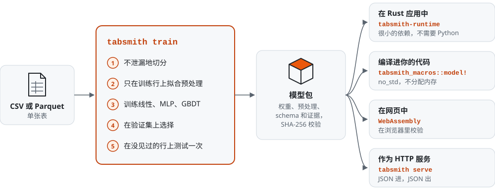
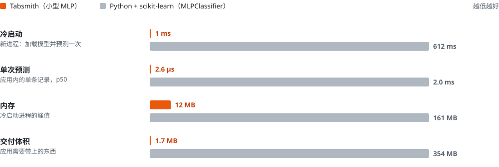

<div align="center">

<picture>
  <source media="(prefers-color-scheme: dark)" srcset="docs/assets/logo-dark.svg">
  
</picture>

# Tabsmith

**用一个 CSV 训练模型，并直接放进你的 Rust 应用——一个工具，不需要 Python。**

[](https://github.com/NatMartini/Tabsmith/actions/workflows/ci.yml)
[](https://github.com/NatMartini/Tabsmith/releases)
[](#许可)
[](#安装)

[English](README.md) · [安装](#安装) · [快速上手](#快速上手) · [四种交付方式](#四种交付方式) · [Tabsmith 与 Python 对比](#tabsmith-与-python-对比) · [文档](#文档)

</div>

<picture>
  <source media="(prefers-color-scheme: dark)" srcset="docs/assets/pipeline-zh-dark.svg">
  
</picture>

```console
$ tabsmith sample-data machines.csv
$ tabsmith train machines.csv --target defect --group device_id
· data machines.csv: 10000 rows × 25 columns, binary target `defect` (positive "1": 1289 rows, negative "0": 8711 rows)
· run-001: training linear (up to 1740 steps)
· run-001: completed (early stopping after epoch 39; weights of best epoch 29 kept)
· run-002: training small-mlp (up to 3480 steps)
· run-002: completed (early stopping after epoch 13; weights of best epoch 5 kept)
· run-003: training gbdt (up to 400 steps)
· run-003: completed (early stopping after epoch 54; weights of best epoch 29 kept)

comparison on the validation split (metric: balanced_accuracy)
  run      candidate  balanced_accuracy  AUC     F1      params  p95 latency  train time
  run-001  linear     0.7644             0.8385  0.4602  36      1 µs         106 ms
  run-002  small-mlp  0.7665             0.8427  0.4843  1697    1 µs         96 ms
  run-003  gbdt       0.7530             0.8461  0.4784  1769    1 µs         797 ms

chosen on validation: run-002 (small-mlp)
test split (1386 rows, used once): balanced accuracy 0.7729  AUC 0.8250  F1 0.4624  precision 0.3325  recall 0.7588
bundle: bundles/run-002 (b-…, evaluated; self-check passed)

$ tabsmith predict --input new.csv --keep unit_id   # 输出预测 CSV
$ tabsmith serve                                    # 在 :8080 提供 HTTP API
```

*（下文“快速上手”的真实输出，有删节：省略了进度行和部分表格列。完整输出见[验收报告](reports/implementation-acceptance.md#one-command-tabsmith-train)。）*

Tabsmith 把一个 CSV 或 Parquet 文件变成一个**经过测试、自包含的模型包（bundle）**，任何 Rust
程序只需一个很小的依赖 `tabsmith-runtime` 就能加载。它覆盖的是整件工作，而不只是模型：不泄漏地切分数据，
只从训练行学习预处理，训练线性基线、小型神经网络和梯度提升树，公平地比较它们，测试集只用一次，
再把胜出的模型连同预处理、schema 和评价证据一起打包。新数据到来时，它会重新训练，并在两个模型都没见过的行上
告诉你新模型是否比已经交付的模型更好。

0.1 版支持**表格二分类、多分类和回归**（流失、缺陷、欺诈、故障类型、剩余寿命……）。在 CPU 上训练，也可以把神经网络放到
GPU（Vulkan、CUDA）上训练；运行时还能编译成 WebAssembly 在网页中运行，模型也可以直接编译进你的 Rust 代码，
一直用到没有标准库的微控制器上。尚未完成的部分见[状态](#状态)；为什么这样设计，见
[设计决策](docs/design-decisions.md)和[技术报告](docs/technical-report.md)。

## 为什么用 Tabsmith

- **一条命令，默认安全。** `tabsmith train data.csv --target y` 依次完成切分 → 预处理 → 训练三个模型 → 在验证集上比较 → 测试一次 → 打包。每一步都有记录、可复现。
- **交付时不需要 Python。** 你的应用只依赖 `tabsmith-runtime`（没有 Burn、没有 Polars、没有 Python）。示例应用是一个 1.7 MB 的二进制文件。
- **也可以把模型编译进代码。** `tabsmith_macros::model!` 在你的 crate 编译时把模型包变成 Rust 代码：输入是类型，不分配内存，不依赖 `std`，在所有平台上与运行时逐位相同。在嵌入式示例中，Kani 模型检查器证明了它的预测对任何可能的输入都不会 panic（[见下文](#编译进你的代码)）。
- **在生产中真正重要的地方够快。** 单条预测在微秒级，从进程启动到第一次预测约 1 毫秒，内存约 12 MB（[见下方数字](#tabsmith-与-python-对比)）。
- **质量与 scikit-learn 一致。** 预处理与 scikit-learn 相差约 2e-7，线性模型与 scikit-learn 在同一目标函数上的最优值相差约 0.1%，指标相差在 1e-12 以内（[实测](reports/implementation-acceptance.md#reference-check-against-scikit-learn)；CI 用[冻结的参考值](fixtures/reference/)以 1e-5、1% 和 1e-12 为界检查）。
- **逐位确定。** 同样的数据和设置得到同样的权重：中断的训练续训后与不中断的训练逐位相同，在 CPU 和经过认证的 GPU 上都是如此（[GPU 上为此做了什么](docs/design-decisions.md#d5-determinism-is-a-contract)）。树模型在任何操作系统上都相同：在 Windows 和 Linux 上[实测](reports/reproducibility/)，权重哈希和训练历史完全一致。
- **很难犯错。** 结构上杜绝训练/测试泄漏，每个数据版本的测试集只用一次，按实体和按时间切分，拒绝而不是静默回退，模型包经过完整性校验，错误信息告诉你下一步该做什么。
- **知道自己知道多少。** 每个模型包都带有 conformal 校准，因此每条预测都附带指定覆盖率的区间或预测集，还带有各输入的置换重要性。树模型可以在单调约束下训练，模型包加载器和编译器都会验证这一约束。`tabsmith serve` 会对照训练统计量报告输入漂移。
- **可信的更新。** 新数据 → 新的 Run；旧模型包和新模型在同一批没见过的行上打分；应用只在新包通过自检后才切换，并且可以回退。

## 安装

预编译二进制（Linux x86_64/arm64、macOS Intel/Apple Silicon、Windows）：

```sh
# Linux / macOS
curl -fsSL https://github.com/NatMartini/Tabsmith/releases/latest/download/install.sh | sh
# Windows (PowerShell)
irm https://github.com/NatMartini/Tabsmith/releases/latest/download/install.ps1 | iex
```

使用 Cargo（Rust 1.95+）：

```sh
cargo install tabsmith-cli          # 编译出 `tabsmith` 命令
cargo binstall tabsmith-cli         # 或下载预编译版本
```

从源码安装：

```sh
git clone https://github.com/NatMartini/Tabsmith tabsmith && cd tabsmith
cargo install --path crates/tabsmith-cli --locked
```

## 快速上手

手头没有数据？生成一份逼真的合成数据集（CC0）并在上面训练：

```sh
tabsmith sample-data machines.csv                       # 1 万行，目标列 `defect`
tabsmith train machines.csv --target defect --group device_id
tabsmith sample-data new.csv --rows 200 --seed 7       # 一些新数据
tabsmith predict --input new.csv --keep unit_id --output predictions.csv
tabsmith report                                         # HTML 报告，位于 .tabsmith/reports/
```

`--group device_id` 让同一台设备的所有行留在同一个子集里（客户、病人、设备——凡是有重复行的实体都应这样做）。
如果每一行都有唯一的键，请改用 `--id <列名>`。

其他任务用法相同，`--task` 选择 recipe：

```sh
tabsmith sample-data modes.csv --task multiclass        # 目标列 `failure_mode`：none、bearing、overheat、seal
tabsmith train modes.csv --target failure_mode --group device_id --task multiclass
tabsmith sample-data hours.csv --task regression        # 目标列 `remaining_hours`
tabsmith train hours.csv --target remaining_hours --group device_id --task regression
```

## 四种交付方式

| 交付方式 | 用法 | 由什么运行模型 |
|---|---|---|
| [在 Rust 应用中](#在-rust-应用中) | `Predictor::load` | `tabsmith-runtime`，一个很小的依赖：没有 Burn、没有 Polars、没有 Python |
| [编译进你的代码](#编译进你的代码) | `tabsmith_macros::model!` | 基于 `tabsmith-embedded` 生成的 Rust 代码：`no_std`，不分配内存 |
| [在网页中](#在网页中) | 编译成 WebAssembly 的运行时 | 浏览器标签页；数据不会上传 |
| [作为 HTTP 服务](#作为-http-服务) | `tabsmith serve` | `tabsmith` 命令，通过 HTTP 收发 JSON |

### 在 Rust 应用中

```toml
[dependencies]
tabsmith-runtime = "0.1"
```

```rust
use tabsmith_runtime::{LoadOptions, Predictor, Record};

fn main() -> Result<(), tabsmith_runtime::TabsmithError> {
    // `tabsmith train` 打印出的模型包（快速上手：设备缺陷合成数据）。
    let model = Predictor::load("bundles/run-002", LoadOptions::cpu())?;
    let reading = Record::new()
        .with("line", "B")
        .with("shift", "night")
        .with("supplier", "S3")
        .with("hours_in_service", 12_000)
        .with("temp_mean", 71.4)
        .with("vibration_rms", 1.42)
        .with("calibration_offset", None::<f64>) // 缺失值按训练时的方式填补
        /* … 模型包的其余所有输入字段 … */;
    let p = model.predict_one(&reading)?;
    println!("{} (p = {:.3})", p.label, p.probability().unwrap_or_default());
    Ok(())
}
```

模型包的每个输入字段都是必需的（用 `None` 表示缺失值）；模型包里的 `input.schema.json` 列出了这些字段，
`examples/input.json` 中有完整的记录。预测结果随任务而定：分类模型用 `probability()`，多分类的每个类别概率用
`probabilities()`，回归用 `value()`。

也可以用 `predict_serialize` 直接预测你自己的 `#[derive(Serialize)]` 结构体。错误包含错误码、字段、期望值和下一步建议；
`{:?}` 会打印完整报告。在运行中的服务里热切换模型：`PredictorHandle::try_update` 只在新包加载并通过自检后才切换
（输入/输出契约发生变化时默认拒绝，除非你显式允许）；`rollback_to` 可以切回旧包。见 [examples/predict-app](examples/predict-app)。

### 编译进你的代码

用 [`tabsmith-macros`](crates/tabsmith-macros)，模型包会在你的 crate 编译时变成 Rust 代码：不需要加载文件，不分配内存，
也不需要标准库：

```rust
tabsmith_macros::model!(defects, "bundles/run-003");   // 编译时校验

let reading = defects::Input {
    line: Some(defects::Line::B),       // 字段名或类别写错都编译不过
    hours_in_service: Some(12_000.0),   // None 按训练时的方式填补
    ..defects::EXAMPLES[0]
};
let p = defects::predict(&reading)?;
```

生成的代码调用的就是运行时自己的内核，所以在所有平台上都与 `tabsmith-runtime` 逐位相同：测试在 7 个模型包、每个数千条随机记录上
检查这一点，CI 在 Linux、macOS 和 Windows 上运行这些测试。单次预测比运行时从 `Record` 预测快 7–27 倍（台式机 CPU 上 0.13–0.59 µs）。
[examples/embedded-predict](examples/embedded-predict) 可以为 Cortex-M4F 微控制器构建，上电时重放模型包的示例；
Kani 模型检查器证明了它的预测对任何可能的输入都不会 panic。

### 在网页中

同一个运行时，原样编译成 WebAssembly：[examples/wasm-predict](examples/wasm-predict) 在浏览器中加载模型包，校验每个文件的
SHA-256、执行自检，按输入 schema 生成表单，并在微秒级完成预测。数据不会上传。在线试用：<https://natmartini.github.io/Tabsmith/>
（由 [Pages 工作流](.github/workflows/pages.yml)构建；仓库启用 GitHub Pages 后页面即可访问）。

### 作为 HTTP 服务

```sh
tabsmith serve --port 8080              # 最新的已评估模型包，或 --bundle <目录>
curl -s localhost:8080/predict --data-binary @bundles/run-002/examples/input.json
# {"bundle_id":"b-…","predictions":[{"is_positive":false,"label":"0","probability":…},…]}
```

接口：`POST /predict`（一条记录、一个数组或 `{"records": [...]}`）、`GET /schema`、`GET /health`、
`GET /stats`（模型包加载以来收到的输入与它自带的训练统计量的对比：每个数值字段标准化后的均值和离散度、每个类别字段未见过的类别比例，以及发生漂移的字段），
以及带 `--allow-reload` 时的 `POST /reload`（只能加载同一目录下的模型包）。服务没有身份认证和超时，默认只监听 `127.0.0.1`；
对外开放前请先看 [SECURITY.md](SECURITY.md)。

## 新数据到来时

在文件末尾追加（或替换文件），然后再次运行 `tabsmith train`：

```console
$ tabsmith train
· new data version: machines.csv is now snapshot s-dc9fc115c6c7, while run-001, run-002, … used snapshot s-0a8635d0d212. …
…
chosen on validation: run-008 (small-mlp)
test split (1844 rows, used once): balanced accuracy 0.7567  AUC 0.8282  F1 0.4688  precision 0.3355  recall 0.7778
previous bundle bundles/run-002 (run-002) on the 1844 test rows it never saw: balanced accuracy 0.7737  AUC 0.8334  F1 0.4936  …
new model run-008 on the same 1844 rows: balanced accuracy 0.7567  AUC 0.8282  F1 0.4688  …
  → about the same: the balanced accuracy difference (-0.0170) is below the ±0.023 resolution of 1844 rows
  `tabsmith predict` uses the newest evaluated bundle; to keep serving the previous one pass --bundle bundles/run-002
bundle: bundles/run-008 (b-…, evaluated; self-check passed)
```

*（[验收运行](reports/implementation-acceptance.md#one-command-tabsmith-train)的删节输出：在文件末尾追加了 3,000 行来自偏移分布的数据；你的 run 编号可能不同。）*
这里已交付的模型在同一批没见过的行上仍略好一些，而且差异在噪声范围内，所以可以继续使用它。在未改变的数据上再次运行
`tabsmith train`，它会保留已有的模型包，而不会再造一个副本。

`predict` 会对模型从未见过的类别（新的月份、产品或代码）发出警告。

## Tabsmith 与 Python 对比

用标准 Python 技术栈（pandas + scikit-learn `ColumnTransformer` + `LogisticRegression` / `MLPClassifier` /
`HistGradientBoostingClassifier`）完成同一任务：相同的行、切分、特征和训练设置，同一台机器。用
[`tools/bench/bench.py`](tools/bench/bench.py) 复现；完整结果和日志见
[reports/benchmarks](reports/benchmarks/2026-10-27-linux-x86_64-v2/)。

<picture>
  <source media="(prefers-color-scheme: dark)" srcset="docs/assets/bench-zh-dark.svg">
  
</picture>

*小型 MLP 与 scikit-learn 的 `MLPClassifier` 对比，每一行各用自己的线性刻度；三对模型的全部数字见下表。
图由 [`tools/readme_assets.py`](tools/readme_assets.py) 根据报告的 `results.json` 绘制。*

<!-- BENCH:START -->
Machine: AMD Ryzen 9 9950X3D2 16-Core Processor, 32 logical CPUs, Linux 6.6.87.2-microsoft-standard-WSL2. Data: 10000 rows (synthetic equipment-defect sample), same split, features and settings on both sides. Python 3.14.4, scikit-learn 1.9.1, pandas 3.1.0, numpy 2.5.4. Tabsmith's linear, small-mlp and gbdt candidates stand next to scikit-learn's LogisticRegression, MLPClassifier and HistGradientBoostingClassifier (HGB). Tabsmith trains on one thread; scikit-learn runs with its defaults (HGB uses every core).

| | Tabsmith linear | scikit-learn logistic | Tabsmith small-mlp | scikit-learn MLP | Tabsmith gbdt | scikit-learn HGB |
|---|---|---|---|---|---|---|
| Test balanced accuracy | 0.7528 | 0.7516 | 0.7729 | 0.7314 | 0.7332 | 0.7295 |
| Test ROC AUC | 0.8202 | 0.8209 | 0.8250 | 0.7928 | 0.8188 | 0.8184 |
| Epochs / rounds / solver iterations | 39 | 25 | 13 | 13 | 54 | 54 |
| Training time | 0.11 s | 0.04 s | 0.10 s | 0.13 s | 0.67 s | 3.66 s |
| Single-record prediction in an app (p50) | 2.4 µs | 1993.2 µs | 2.6 µs | 2006.5 µs | 3.0 µs | 2844.1 µs |
| Single-record prediction (p99) | 5.5 µs | 2562.6 µs | 4.9 µs | 2681.7 µs | 6.7 µs | 4456.8 µs |
| Batch prediction in process | 787,675 rows/s | 736,904 rows/s | 641,489 rows/s | 400,931 rows/s | 523,179 rows/s | 731,173 rows/s |
| Cold start: new process, load model, predict 1 record | 1 ms | 618 ms | 1 ms | 612 ms | 1 ms | 625 ms |
| Peak memory of that process | 12 MB | 160 MB | 12 MB | 161 MB | 12 MB | 164 MB |
| Model artifact | 0.0 MB | 0.0 MB | 0.0 MB | 0.1 MB | 0.1 MB | 0.2 MB |

| Deployment footprint | Tabsmith | Python |
|---|---|---|
| What the application ships | 1.7 MB binary (depends on tabsmith-runtime only) | 354.1 MB environment (Python + numpy + scipy + scikit-learn + pandas + joblib) |
| Training tool | 29.4 MB `tabsmith` binary | the same environment |
| Train all three candidates from the CSV | 0.98 s for the whole `tabsmith run` process (read, profile, split, preprocess, train, validate, checkpoints), peak 44 MB | 3.83 s for read_csv + three fits (imports and process start not included) |
<!-- BENCH:END -->

结论：质量相当——梯度提升树与 `HistGradientBoostingClassifier` 持平（ROC AUC 0.8188 对 0.8184），小 MLP 在这里比
`MLPClassifier` 更好。两边的训练都在一秒左右或更短：scikit-learn 的 lbfgs 拟合线性模型比 Tabsmith 的小批量 Adam 更快，而在这个小问题上
Tabsmith 的梯度提升树（做这次基准时还是单线程）反而快于使用 32 个线程的 HGB；现在树会用上所有核心，求和按固定顺序合并，结果在任何机器上都一样。真正的差别在于**交付模型**：在应用中单条预测约
2.5 µs 而不是 2–3 ms，新进程 1 ms 就能给出预测而不是 0.6 s，内存 12 MB 而不是 160 MB，应用是一个 1.7 MB 的二进制文件而不是
354 MB 的 Python 环境。

在三个公开数据集（UCI Adult、California Housing、UCI Covertype）上，每个候选在同样的行和切分上都与 scikit-learn 的对应模型持平，
差异在测试集噪声以内，树模型一致到小数点后三位。Tabsmith 输的地方是较大问题上树的训练时间：比 `HistGradientBoosting` 慢 17 到 21 倍，
原因是每个叶子的直方图都从自己的行重新构建，而且求和顺序固定（[reports/datasets](reports/datasets/)）。

### 否则你需要自己写的部分

| | Tabsmith | 典型的 Python 项目 |
|---|---|---|
| 只在训练行上拟合预处理，推理时原样复用 | 内置，只有一份实现 | 自己写（泄漏和训练/服务偏差的常见来源） |
| 按实体切分（同一客户不会同时出现在训练集和测试集） | `--group` | 自己写 |
| 每个数据版本的测试集只用一次，并有记录 | 强制执行 | 靠自觉 |
| 数据更新后，新旧模型在同一批没见过的行上对比 | `tabsmith train` 自动完成 | 自己写 |
| 模型 + 预处理 + schema + 标签映射 + 证据，在一个经过校验的产物里 | 模型包（bundle） | pickle/joblib + 约定 |
| 崩溃后精确、逐位一致地续训 | `tabsmith resume` | 很少有 |
| 带稳定错误码和下一条命令的可操作错误 | 每个错误都有 | 堆栈跟踪 |

### 与其他工具的关系

| | 它们是什么 | Tabsmith 的不同之处 |
|---|---|---|
| **scikit-learn、LightGBM、XGBoost** | Python 和 C++ 的参考训练库 | Tabsmith 是一个工具做完整件事：从 CSV 到经过校验的模型包，并且不带 Python 交付。它的树是朴素的直方图 GBDT（没有采样，没有原生类别分裂）；在 README 的问题上与 scikit-learn 的 `HistGradientBoostingClassifier` 质量相当（[见上](#tabsmith-与-python-对比)）。LightGBM 和 XGBoost 在大数据上训练更快，这里没有测量 |
| **[linfa](https://github.com/rust-ml/linfa)、[smartcore](https://github.com/smartcorelib/smartcore)** | Rust 里仿 scikit-learn 的算法集合 | 它们给你算法；Tabsmith 给你算法周围的工作流：不泄漏的切分、唯一的一份预处理实现、测试集台账、模型包、精确续训、conformal 区间，以及带证明的、编译成 `no_std` 代码的模型。Tabsmith 不打算提供所有算法 |
| **[Burn](https://burn.dev)、[candle](https://github.com/huggingface/candle)** | Rust 的深度学习框架 | Tabsmith 用 Burn 训练神经网络，也可以是二者的用户。它的运行时不依赖任何一个：推理只是 200 行内核，和编译进代码的模型共用 |
| **[PyO3](https://pyo3.rs)、ONNX 运行时** | 从 Rust 调 Python，或运行导出的模型 | 两者都把模型留在 Rust 类型系统之外。Tabsmith 的 `model!` 把模型的契约变成类型、权重变成常量，字段或类别写错编译不过，编译器还能给出输出范围并生成证明 |

## 工作原理

```
tabsmith-contracts   配置分层、错误、schema、Run/模型包/评价记录
tabsmith-embedded    数值内核（no_std），运行时和编译进代码的模型共用
tabsmith-runtime     模型包校验、共享变换、模型执行、Predictor        ← 你的应用依赖它
tabsmith-macros      model!：在编译时把模型包变成 Rust 代码             ← ……或者依赖它
tabsmith-workflow    快照、切分、拟合、训练（Burn：CPU、Vulkan、CUDA；自研 GBDT）、评估、打包、报告
tabsmith-cli         `tabsmith` 命令（train、run、compare、evaluate、bundle、predict、serve、report……）
```

候选模型是线性模型、小型 MLP（用 [Burn](https://burn.dev) 训练）和梯度提升树（Tabsmith 自己实现的确定性直方图 GBDT）。
GPU 训练需要单独构建（`cargo install tabsmith-cli --features gpu`）；只有在该机器上经过
[认证](docs/design-decisions.md#d11-gpu-training-is-opt-in-planned-and-certified)且预计更快时，才会自动选择 GPU。

每一步也都有单独的命令（`tabsmith plan`、`run`、`compare`、`evaluate`、`bundle build`、`resume`……）——见
`tabsmith --help` 和[文档](#文档)。

## 状态

Tabsmith 0.1 还很年轻。已经可靠且有测试覆盖的部分（179 个自动测试和 7 个文档测试，其中包括驱动真实二进制的进程级测试和性质测试）：
上面三种任务的工作流、精确续训、模型包与运行时、编译进代码的模型（并用 [Kani 证明](reports/kani/)其预测不会 panic），以及与 scikit-learn 的参考对照。[验收报告](reports/implementation-acceptance.md)
为每一项提供了实测证据。三条 GPU 路径已[认证](reports/gpu/)，模型包加载器经过 530 万次输入的[模糊测试](reports/fuzz/)，没有崩溃。
树模型在 [100 万行](reports/scaling/)上端到端训练 42 秒、内存 1.6 GB，并且在 [Windows 和 Linux 上得到同一个模型](reports/reproducibility/)。

尚未完成的部分（有的是有意为之，有的是缺少硬件）：

- **GPU**：需要单独构建。GPU 路径只在实际运行过的硬件上认证（Windows 上的 RTX 5090 和 AMD 核显，见 [reports/gpu](reports/gpu/)）；CUDA 用 TF32 训练，必须显式声明（`execution.precision = "tf32"`），因为矩阵乘法库没有 fp32 开关。请求不存在的 GPU 会报错，绝不会静默回退。
- **平台**：在 Linux x86_64 上认证，上面的验收运行就在该平台上完成。完整测试套件也在 Windows x86_64 上通过，并在 CI 的 macOS（Apple Silicon）上通过；按 0.1 版的设计，这两者都报告为“未认证”。Linux arm64 和 macOS Intel 二进制只构建、未测试。
- **任务**：单表上的二分类、多分类和回归，支持分层、按实体（`--group`）和按时间（`--time`）切分。不支持排序、生存分析和多表数据。
- **macOS**：只由 CI 的 Apple Silicon runner 检查，还没有人在 Mac 上手动运行过 Tabsmith。报告里 Linux 上的结果来自开发机上的 WSL。
- **用户**：还没有正式的用户研究——非常欢迎反馈和 issue。

[实施待办](docs/implementation-backlog.md)列出了每个计划条目的状态。

## 参与贡献

附带复现步骤的问题报告、测试和谨慎的修复最有价值。[贡献指南](CONTRIBUTING.md#中文)写明了基本规则，以及如何在本地跑完 CI
的全部检查。问题和想法欢迎提到 [issues](https://github.com/NatMartini/Tabsmith/issues)。

## 文档

[技术报告](docs/technical-report.md) · [设计决策](docs/design-decisions.md) ·
[架构](docs/architecture.md) · [配置](docs/configuration.md) · [模型包格式](docs/bundle-format.md) ·
[错误](docs/errors.md) · [扩展走查（LLM 任务）](docs/extension-walkthrough-llm.md) ·
[贡献指南](CONTRIBUTING.md) · [更新日志](CHANGELOG.md) · [报告](reports/)

## 许可

可在 [Apache License 2.0](LICENSE-APACHE) 或 [MIT license](LICENSE-MIT) 中任选其一。附带的样例数据生成器产生的是合成数据（CC0）。
