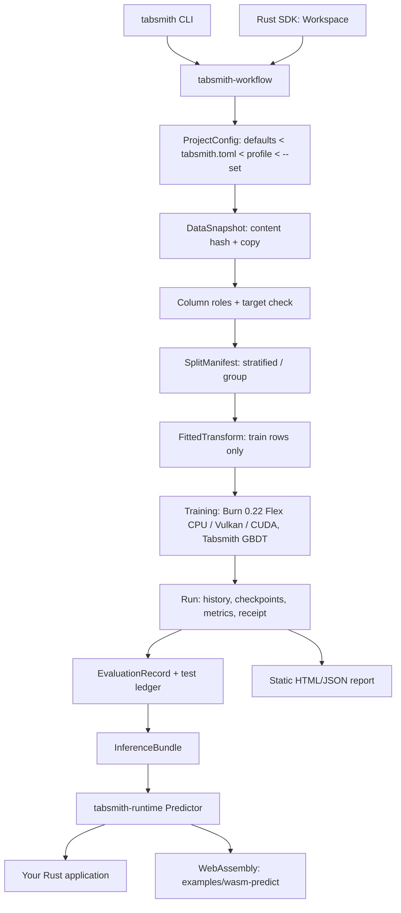

# Architecture

[中文](#中文)

## Stages and records

Every arrow crosses a contract defined in `tabsmith-contracts` with an explicit
format version. Stages are content-addressed so unchanged inputs are reused (R1)
and changed inputs invalidate exactly the dependent stages:

| Stage | Identity (hash of) | Stored at |
|---|---|---|
| Snapshot `s-…` | file SHA-256, read options, snapshot mode, id column | `.tabsmith/snapshots/<id>/` (copy of the file + `snapshot.json`) |
| Split `sp-…` | snapshot, strategy, seed, fractions, target, positive label, group column, algorithm version | `.tabsmith/splits/<id>.json` (one digit per row) |
| Transform `t-…` | split, preprocessing config, column roles, transform version, threshold | `.tabsmith/transforms/<id>/fitted.json` |
| Run `run-NNN` | sequential; records all of the above + config hash | `.tabsmith/runs/<id>/` |
| Bundle `b-…` | SHA-256 of all bundle files | `bundles/<run-id>/` |

## One preprocessing implementation

`tabsmith_runtime::transform::apply_transform` is the only code that turns raw
values into model inputs. Training (`Workspace::split_data`), evaluation, offline
CSV prediction (`tabsmith predict`) and application prediction (`Predictor`) all
call it with the frozen `FittedTransform`. Fitting (`tabsmith_workflow::fit`)
uses the runtime's coercion functions (`coerce_numeric`, `coerce_category`) so
the value semantics are shared too.

Raw values are typed (`Null`, `Bool`, `Int`, `Float`, `Text`) and coercion is
strict: a number sent as text is an error, integral floats and integers map to
the same category, `NaN` is a missing value by default (`preprocess.nan`), ±inf
is rejected.

## Tasks

The recipe fixes the task: `tabular-binary@0.1`, `tabular-multiclass@0.1` or
`tabular-regression@0.1`. Every task-dependent value is an enum whose variants carry
exactly that task's data: targets (`Targets`), metrics (`Metrics`, tagged by `task` in
JSON), and the runtime's prediction outcome (`Outcome`, flattened into `Prediction`).
Regression targets are learned standardised; the scale is part of the output schema, so
predictions come back in the target's units.

## Training engines and runtime

The networks (`linear`, `small-mlp`) train with Burn 0.22 on the Flex CPU backend
(single thread), or on a GPU (below). Tabsmith initialises weights from its own
versioned PRNG, uses a minibatch order that is a pure function of `(seed, epoch)` and has
no stochastic layers, so a checkpoint (model record + Adam state + loop state + best
weights) is enough for an exact resume. Validation after each epoch runs the runtime on
all cores, rows split between threads; every row is computed exactly as on one thread.

`gbdt` is Tabsmith's own histogram gradient boosting (`tabsmith-workflow/src/gbdt.rs`),
trained on the same fitted features. One boosting round is one epoch of the same
training state, so checkpoints, cancellation and exact resume work alike. Sums run in
row order on one thread and leaf values are rounded to f32 before they update the
scores, so training is deterministic and the runtime reproduces the trainer exactly.

The runtime executes the engine-neutral model (`model.config.json`: dense layers, or a
`tabsmith.trees.v1` tree ensemble) with its own small FP32 kernels. Each run records
the max output difference between the engine and the runtime on validation rows
("engine Δ", ~1e-7 for networks, 0 for trees).

The runtime crate does not depend on Burn or Polars. `examples/predict-app` is a
standalone Cargo project whose dependency tree proves it, and `examples/wasm-predict`
compiles the unchanged runtime to WebAssembly.

The kernels live in `tabsmith-embedded`, a `no_std` crate without allocation whose only
dependency is `libm`. `tabsmith-macros` uses them too: `model!(name, "path")` verifies a
bundle with the runtime while the application compiles, and generates a module with the
model's input contract as types, the weights as constants, and a `predict` that calls the
same kernels. A compiled model therefore predicts exactly what the runtime predicts, and
`exp` from `libm` makes both the same on every platform (`tests/equivalence.rs` and
`tests/portable.rs` in `tabsmith-macros`). `examples/embedded-predict` builds two
compiled models for a Cortex-M4F microcontroller (D14).

## Devices

`DevicePlan` is computed before training: requested device, compiled backends, detected
hardware (read-only), selected backend, precision, certification, data placement, copy
path, memory estimate. After training a `DeviceReceipt` records what actually ran and
whether it matched the plan. Nothing falls back silently: a device that is not compiled
in, not present, or not able to train at the requested precision is an error.

GPU training is compiled in with the Cargo features `vulkan` and `cuda` (`gpu` on the
CLI). It runs Burn's CubeCL backends with kernel fusion and without autotuning, because
autotuning picks kernels by timing and two processes could train different weights.
CUDA on compute capability 8.0+ computes f32 matrix products in TF32 and therefore needs
`execution.precision = "tf32"`; Vulkan computes fp32. `auto-certified` uses a GPU only
if it is listed in `certified_devices.json` (written from the evidence of
`tools/gpu_certify.py`, in `reports/gpu/`) and the cost model expects it to be at least
twice as fast as the CPU. `gbdt` always trains on the CPU. The reasons behind these rules
are in [design-decisions.md](design-decisions.md) (D5, D11).

---

## 中文

### 阶段与记录

上图中每个箭头都跨越 `tabsmith-contracts` 中定义、带显式格式版本的契约。各阶段按内容寻址：输入不变时复用（R1），输入变化时只让依赖它的阶段失效。

| 阶段 | 身份（对以下内容求哈希） | 存放位置 |
|---|---|---|
| 快照 `s-…` | 文件 SHA-256、读取选项、快照模式、id 列 | `.tabsmith/snapshots/<id>/`（文件副本 + `snapshot.json`） |
| 切分 `sp-…` | 快照、策略、种子、比例、目标列、正类、分组列、算法版本 | `.tabsmith/splits/<id>.json`（每行一个数字） |
| 变换 `t-…` | 切分、预处理配置、列角色、变换版本、阈值 | `.tabsmith/transforms/<id>/fitted.json` |
| Run `run-NNN` | 顺序编号；记录以上全部及配置哈希 | `.tabsmith/runs/<id>/` |
| Bundle `b-…` | 包内全部文件的 SHA-256 | `bundles/<run-id>/` |

### 只有一份预处理实现

`tabsmith_runtime::transform::apply_transform` 是把原始值变成模型输入的唯一代码。训练、评估、离线 CSV 预测（`tabsmith predict`）和应用内预测（`Predictor`）都用冻结的 `FittedTransform` 调用它。拟合阶段也使用运行时的类型转换函数，因此值语义同样共享。

原始值带类型（`Null`、`Bool`、`Int`、`Float`、`Text`），转换是严格的：用文本发送数字会报错；整数和整数值浮点数映射到同一类别；`NaN` 默认视为缺失（`preprocess.nan`）；±inf 被拒绝。

### 任务

recipe 决定任务：`tabular-binary@0.1`、`tabular-multiclass@0.1` 或 `tabular-regression@0.1`。所有与任务相关的值都是枚举，每个变体只携带该任务的数据：目标（`Targets`）、指标（`Metrics`，JSON 中以 `task` 标记）、运行时的预测结果（`Outcome`，展平进 `Prediction`）。回归目标以标准化形式学习，尺度写在输出 schema 中，因此预测值使用目标列本身的单位。

### 训练引擎与运行时

神经网络（`linear`、`small-mlp`）使用 Burn 0.22 的 Flex CPU 后端（单线程）训练，也可以在 GPU 上训练（见下）。Tabsmith 用自带的、有版本的伪随机数生成器初始化权重；小批次顺序只取决于 `(seed, epoch)`；没有随机层。因此检查点（模型记录 + Adam 状态 + 循环状态 + 最佳权重）足以精确续训。每个 epoch 之后的验证在所有核心上运行运行时，按行分给各线程；每一行的计算与单线程完全相同。

`gbdt` 是 Tabsmith 自己实现的直方图梯度提升树（`tabsmith-workflow/src/gbdt.rs`），使用同样的拟合特征。一轮提升就是同一训练状态中的一个 epoch，因此检查点、取消和精确续训的机制完全相同。求和在单线程上按行序进行，叶子值在更新得分前先舍入到 f32，所以训练是确定的，运行时能精确复现训练端的输出。

运行时用自己的小型 FP32 内核执行与引擎无关的模型（`model.config.json`：全连接层，或 `tabsmith.trees.v1` 树集成）；每个 Run 记录引擎与运行时在验证集上输出的最大差异（“engine Δ”，网络约 1e-7，树为 0）。

运行时 crate 不依赖 Burn 或 Polars。`examples/predict-app` 是独立的 Cargo 项目，其依赖树可以证明这一点；`examples/wasm-predict` 把未经修改的运行时编译成 WebAssembly。

这些内核放在 `tabsmith-embedded` 中：一个不分配内存的 `no_std` crate，唯一的依赖是 `libm`。`tabsmith-macros` 也调用它们：`model!(name, "path")` 在应用编译时用运行时校验模型包，并生成一个模块——模型的输入契约是类型，权重是常量，`predict` 调用同一套内核。因此编译进代码的模型与运行时的预测完全相同；`exp` 来自 `libm`，两者在所有平台上也相同（见 `tabsmith-macros` 的 `tests/equivalence.rs` 和 `tests/portable.rs`）。`examples/embedded-predict` 把两个模型编译进可在 Cortex-M4F 微控制器上运行的库（D14）。

### 设备

训练前先计算 `DevicePlan`：请求的设备、编译进来的后端、探测到的硬件（只读）、选中的后端、精度、认证状态、数据放置、拷贝路径和内存估计。训练后由 `DeviceReceipt` 记录实际运行情况以及是否与计划一致。不会静默回退：未编译进来、不存在或无法以所需精度训练的设备都会报错。

GPU 训练通过 Cargo 特性 `vulkan` 和 `cuda`（CLI 为 `gpu`）编译进来，使用 Burn 的 CubeCL 后端，开启核融合、关闭 autotune（autotune 按计时选择内核，两个进程可能训练出不同的权重）。计算能力 8.0 及以上的 CUDA 设备用 TF32 计算 f32 矩阵乘法，因此需要 `execution.precision = "tf32"`；Vulkan 按 fp32 计算。`auto-certified` 只会使用列在 `certified_devices.json` 中（来自 `tools/gpu_certify.py` 的证据，见 `reports/gpu/`）、且成本模型预计至少快一倍的 GPU。`gbdt` 始终在 CPU 上训练。这些规则背后的理由见 [design-decisions.md](design-decisions.md)（D5、D11）。
