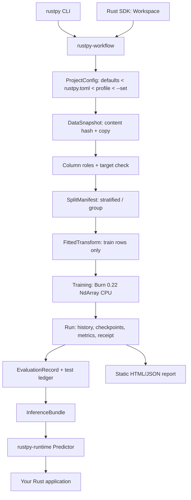

# Architecture

[中文](#中文)

## Stages and records

Every arrow crosses a contract defined in `rustpy-contracts` with an explicit
format version. Stages are content-addressed so unchanged inputs are reused (R1)
and changed inputs invalidate exactly the dependent stages:

| Stage | Identity (hash of) | Stored at |
|---|---|---|
| Snapshot `s-…` | file SHA-256, read options, snapshot mode, id column | `.rustpy/snapshots/<id>/` (copy of the file + `snapshot.json`) |
| Split `sp-…` | snapshot, strategy, seed, fractions, target, positive label, group column, algorithm version | `.rustpy/splits/<id>.json` (one digit per row) |
| Transform `t-…` | split, preprocessing config, column roles, transform version, threshold | `.rustpy/transforms/<id>/fitted.json` |
| Run `run-NNN` | sequential; records all of the above + config hash | `.rustpy/runs/<id>/` |
| Bundle `b-…` | SHA-256 of all bundle files | `bundles/<run-id>/` |

## One preprocessing implementation

`rustpy_runtime::transform::apply_transform` is the only code that turns raw
values into model inputs. Training (`Workspace::split_data`), evaluation, offline
CSV prediction (`rustpy predict`) and application prediction (`Predictor`) all
call it with the frozen `FittedTransform`. Fitting (`rustpy_workflow::fit`)
uses the runtime's coercion functions (`coerce_numeric`, `coerce_category`) so
the value semantics are shared too.

Raw values are typed (`Null`, `Bool`, `Int`, `Float`, `Text`) and coercion is
strict: a number sent as text is an error, integral floats and integers map to
the same category, `NaN` is a missing value by default (`preprocess.nan`), ±inf
is rejected.

## Training engine and runtime

Training uses Burn 0.22 with the NdArray CPU backend (single thread). RustPy
initialises weights from its own versioned PRNG, uses a minibatch order that is
a pure function of `(seed, epoch)` and has no stochastic layers, so a checkpoint
(model record + Adam state + loop state + best weights) is enough for an exact
resume. The runtime executes the engine-neutral `model.config.json` with its own
small FP32 kernel; each run records the max logit difference between the engine
and the runtime on validation rows ("engine Δ", typically ~1e-7).

The runtime crate does not depend on Burn or Polars. `examples/predict-app` is a
standalone Cargo project whose dependency tree proves it.

## Devices

`DevicePlan` is computed before training: requested device, compiled backends,
detected hardware (read-only), selected backend, precision, data placement,
copy path, memory estimate. In this build only the CPU path is compiled and
certified. Requests for `cuda`/`wgpu`/`rocm`/`metal` fail with
`E_DEVICE_UNSUPPORTED`; nothing falls back silently. After training a
`DeviceReceipt` records what actually ran and whether it matched the plan.

---

## 中文

### 阶段与记录

上图中每个箭头都跨越 `rustpy-contracts` 中定义、带显式格式版本的契约。各阶段按内容寻址：输入不变时复用（R1），输入变化时只让依赖它的阶段失效。

| 阶段 | 身份（对以下内容求哈希） | 存放位置 |
|---|---|---|
| 快照 `s-…` | 文件 SHA-256、读取选项、快照模式、id 列 | `.rustpy/snapshots/<id>/`（文件副本 + `snapshot.json`） |
| 切分 `sp-…` | 快照、策略、种子、比例、目标列、正类、分组列、算法版本 | `.rustpy/splits/<id>.json`（每行一个数字） |
| 变换 `t-…` | 切分、预处理配置、列角色、变换版本、阈值 | `.rustpy/transforms/<id>/fitted.json` |
| Run `run-NNN` | 顺序编号；记录以上全部及配置哈希 | `.rustpy/runs/<id>/` |
| Bundle `b-…` | 包内全部文件的 SHA-256 | `bundles/<run-id>/` |

### 只有一份预处理实现

`rustpy_runtime::transform::apply_transform` 是把原始值变成模型输入的唯一代码。训练、评估、离线 CSV 预测（`rustpy predict`）和应用内预测（`Predictor`）都用冻结的 `FittedTransform` 调用它。拟合阶段也使用运行时的类型转换函数，因此值语义同样共享。

原始值带类型（`Null`、`Bool`、`Int`、`Float`、`Text`），转换是严格的：用文本发送数字会报错；整数和整数值浮点数映射到同一类别；`NaN` 默认视为缺失（`preprocess.nan`）；±inf 被拒绝。

### 训练引擎与运行时

训练使用 Burn 0.22 的 NdArray CPU 后端（单线程）。RustPy 用自带的、有版本的伪随机数生成器初始化权重；小批次顺序只取决于 `(seed, epoch)`；没有随机层。因此检查点（模型记录 + Adam 状态 + 循环状态 + 最佳权重）足以精确续训。运行时用自己的小型 FP32 内核执行与引擎无关的 `model.config.json`；每个 Run 记录引擎与运行时在验证集上 logit 的最大差异（“engine Δ”，通常约 1e-7）。

运行时 crate 不依赖 Burn 或 Polars。`examples/predict-app` 是独立的 Cargo 项目，其依赖树可以证明这一点。

### 设备

训练前计算 `DevicePlan`：请求的设备、已编译后端、检测到的硬件（只读）、选中的后端、精度、数据放置、复制路径、内存估算。本版本只编译并认证了 CPU 路径。请求 `cuda`/`wgpu`/`rocm`/`metal` 会以 `E_DEVICE_UNSUPPORTED` 失败，不会静默回退。训练后 `DeviceReceipt` 记录实际运行情况以及是否与计划一致。
